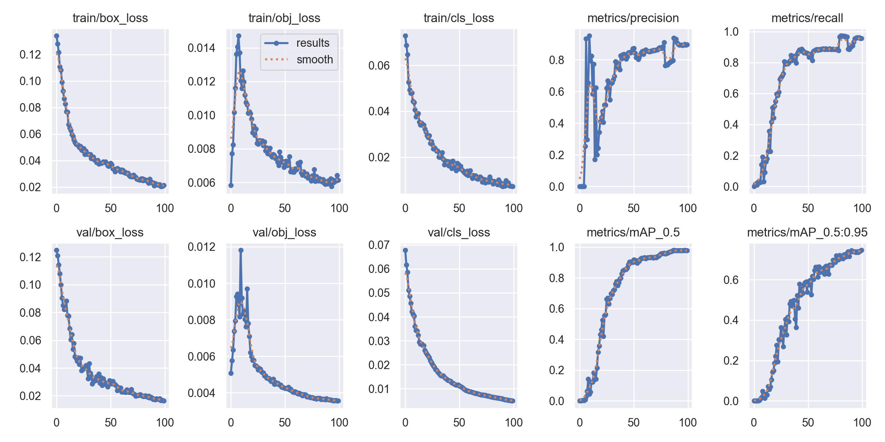
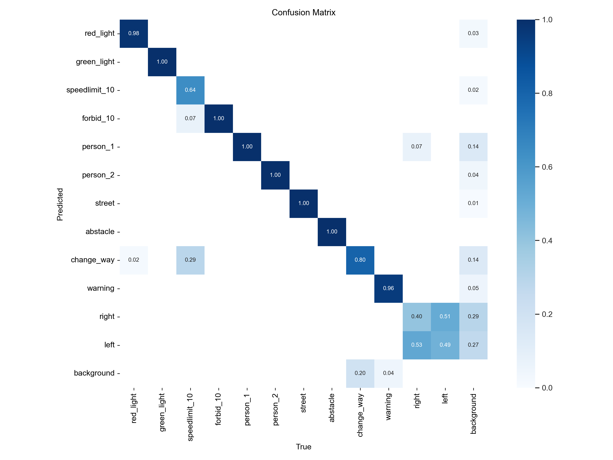
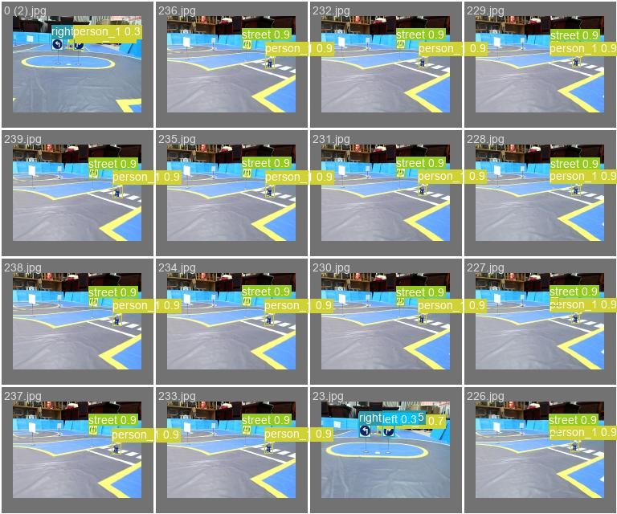

# YOLOv5 Auto-Iterate

**双模型交叉验证的自动标注 + 迭代微调流水线** —— 把「自动标注 → 人工复核 → 数据回灌 → 再训练」串成一个能反复跑的闭环。

**任务无关**：代码里没有任何具体物体的假设（不写死类别名、不写死类别数），换数据集 + 换权重即可用于任意检测任务。

## 它解决什么问题

人工标注是 YOLO 项目里最贵的一环。训练出一个模型之后：

- 让模型**自动标注**新图片 —— 快，但单模型会出错，直接当标签用就是往训练集里灌噪声；
- **全人工标** —— 准，但慢。

本流水线用**双模型交叉验证**当质量闸门：只自动采纳「两个模型都同意」的样本；不同意的交给人工，并且**先用单模型预标注出草稿**，人只需要「改」而不是从零「画」。通过的数据自动回灌训练集，进入下一轮迭代。

## 效果

在自建的 **12 类交通标志 / 道路场景数据集**上（红绿灯、限速牌、禁令牌、行人、路面标识、障碍物、变道、警告、左右转等）：

| 训练轮次 | 起始方式 | epochs | mAP@0.5（最佳） |
|---|---|---|---|
| `exp` | 从零训练 | 100 | **0.9795** |
| `exp2` | 微调 | 30 | **0.9823** |
| `exp3` | 微调 | 30 | 0.9787 |
| `exp4` | 微调 | 20 | 0.9776 |
| `exp5` | 微调 | 20 | 0.9746 |

> 数字取自各轮训练目录下的 `results.csv`（YOLOv5 原生逐 epoch 训练日志），不是事后估算。

**可复现性说明（重要）**：上述实验使用的**数据集与模型权重未随本仓库开源**，
因此这张表**无法通过本仓库直接复现**。本仓库开源的是**方法**（流水线代码），不是实验数据。
如需复现，请准备自己的数据集，按下文的用法运行。

### 训练曲线与检测效果（取自 `exp` 轮次）

*训练过程*



*混淆矩阵（12 类）*



*验证集检测效果（绿框为模型预测）*



## 流程图

```
data/unlabeled ──► dual_check（双模型严格一致？）
                        │
                        ├── 一致 ────► data/auto_agreed/    图+标签 ──┐ 采纳
                        │                                              │
                        └── 不一致 ──► data/need_review/    纯图      │
                                            │                          │
                                            ▼ auto_label（单模型）      │
                                       data/review_drafts/ 图+草稿标签  ✗ 永不采纳
                                            │                          │
                                            ▼ 人工修正
                                       data/approved/      图+标签 ──┤ 采纳
                                                                       │
                    ┌──────────────────────────────────────────────────┘
                    ▼
        merge_labeled ──► 训练集 ──► train.py ──► expN+1 ──► 下一轮
```

## 目录约定

| 目录 | 内容 | 进训练集 |
|---|---|---|
| `data/auto_agreed/` | 双模型严格一致（图 + 标签） | ✅ |
| `data/need_review/` | 双模型不一致（只有图） | — |
| `data/review_drafts/` | 单模型草稿（图 + 草稿标签） | ❌ **永不** |
| `data/approved/` | 人工改完确认采用（图 + 标签） | ✅ |
| `data/unlabeled/` | 待标注图（由 find_unlabeled 产出） | — |

## 安装

本流水线是 YOLOv5 的插件，脚本假设自己位于 `<yolov5>/auto_iterate/`：

```bash
cd <你的 yolov5 根目录>
git clone https://github.com/jinyuxiang-sudoqq/yolov5-auto-iterate.git auto_iterate
```

依赖：先装好 YOLOv5 自己的 `requirements.txt`（torch / opencv 等），再补一条 `pip install pyyaml`。

## 用法

在 **yolov5 根目录**下执行：

```bash
python auto_iterate/auto_iterate.py \
  --data data/my_data.yaml \
  --merge-images data/train/images \
  --merge-labels data/train/labels \
  --rounds 3 --epochs 50 --batch 16
```

`--merge-images` / `--merge-labels` **必须**指向 `my_data.yaml` 里 `train:` 的同一条路径，否则新数据会进一个没人读的目录。

数据集 yaml 模板见 `examples/my_data.yaml`，复制到 `<yolov5>/data/my_data.yaml` 后按自己的数据改。

## 脚本

| 脚本 | 作用 |
|---|---|
| `auto_iterate.py` | 主流程：串起 5 步循环 |
| `find_unlabeled.py` | 找出没有同名 `.txt` 的图片 |
| `dual_check.py` | 双模型严格一致校验，分流 auto_agreed / need_review |
| `auto_label.py` | 单模型预标注，产出草稿，加速人工复核 |
| `check_dataset.py` | 训练前校验数据集 yaml 的 names 与权重一致 |

各脚本都支持 `--help`。

## 三道护栏（防静默出错）

1. **类别集合一致性** —— `dual_check.py` 会比较两个权重的 `.names`，不一致直接中止。
   原因：一致性判定是**按类别索引**比较的。若模型 A 的索引 0 是「红灯」、模型 B 的索引 0 是「狗」，两边"索引 0 一致"会被判为通过，进而写出**完全错误的标签**，而且是**静默**的。
2. **yaml ↔ 权重一致** —— 训练前由 `check_dataset.py` 校验数据集 yaml 的 `names` 与权重一致，防止微调时标签索引错位。
3. **任务隔离** —— `--exp-root` 指定 exp 所在目录；不同数据集的 exp 分开放，避免不同类别集合的任务被混在一起交叉验证。

## 设计要点

- **草稿永不进训练集**：单模型没有质量闸门。草稿写在独立目录，只有人工挪进 `approved/` 才算通过。
- **默认安全**：不审 = 不采纳。踩过的坑：若草稿直接写进待复核目录、并沿用「有 `.txt` 即通过」的规则，那么不审就等于全部采纳，训练集被静默污染。
- **成对写入**：一致 / 通过的数据都是「图 + 同名标签」成对复制（YOLOv5 训练要求 images 与 labels 成对同名）。
- **失败即中止**：主流程任何一步失败都会停下，不会带着坏状态继续往下跑。

## 限制（重要）

- **不能凭空识别新物体**：模型只能输出它训练过的类别。新类别必须先人工标一批种子数据 → 重训 → 之后才能自动标注。这是所有目标检测器的共同边界，不是本项目的缺陷。
- **容易受域偏移影响**：如果新数据与训练数据分布差太远，双模型一致率会暴跌，几乎所有图都会进人工复核。
- 至少需要 **2 个 exp**（两代权重）才能做交叉验证。
- 标签必须是 YOLO 格式：`cls xc yc w h`（归一化）。
- 想要跨任务的零样本能力，需要开放词表检测（YOLO-World / Grounding DINO 等），不在本项目范围内。

## 参考

本项目是 [YOLOv5](https://github.com/ultralytics/yolov5) 的外挂式流水线，**不包含** YOLOv5 源码，需要配合一份 YOLOv5 仓库使用。YOLOv5 采用 AGPL-3.0 许可。

## 许可

MIT
